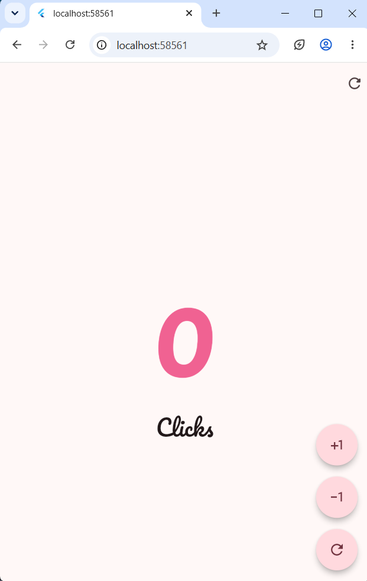
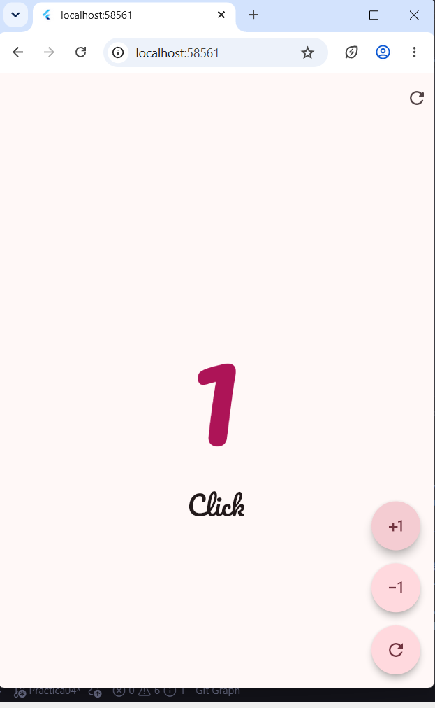
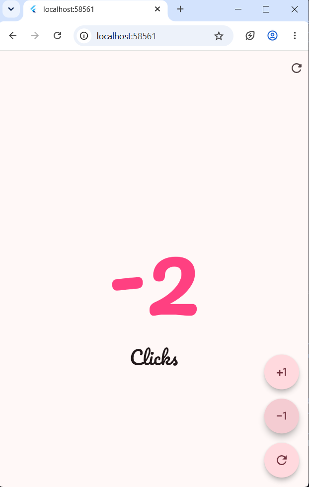

<p align="center">
  
  &nbsp;&nbsp;&nbsp;&nbsp;
  
</p>

# 🌸 Práctica 02 — Primera Aplicación Móvil con Flutter 📱💗

<p align="center">
  💗✨ <strong>Desarrollo Móvil Integral</strong> ✨💗
</p>

<p align="center">
  <strong>Primera Aplicación Móvil con Flutter</strong>
</p>

<p align="center">
  🌸 Contador interactivo en tonos rosas desarrollado con Flutter y Dart 🌸
</p>

---

## 🎀 Descripción

En esta práctica se desarrolló una aplicación móvil sencilla utilizando **Flutter** y el lenguaje de programación **Dart**.

La aplicación consiste en un **contador interactivo** que permite aumentar, disminuir y restablecer su valor mediante botones flotantes. La interfaz está diseñada completamente en **tonos rosas**: el tema de la aplicación, los botones y el color del número cambian según el estado del contador.

| Estado | Valor del contador | Tono de rosa |
| :----: | :----------------: | :----------: |
| 🌷 **Neutro** | `0` | Rosa medio |
| 💗 **Positivo** | mayor a `0` | Rosa oscuro |
| 🌺 **Negativo** | menor a `0` | Rosa vivo |

El propósito de la práctica es introducir los conceptos fundamentales del desarrollo de interfaces móviles con Flutter: **widgets, manejo de estado, eventos de usuario y actualización dinámica de la interfaz**.

---

## 🌷 Tecnologías utilizadas

| Tecnología | Descripción |
| ---------- | ----------- |
| 💙 **Flutter** | Framework utilizado para desarrollar la aplicación móvil. |
| 🎯 **Dart** | Lenguaje de programación utilizado por Flutter. |
| 🎨 **Material Design 3** | Componentes y estilos visuales de la interfaz. |
| 🔤 **google_fonts** | Paquete que permite usar la tipografía cursiva **Pacifico**. |
| 🔊 **SystemSound** | Reproduce el sonido de clic del sistema al presionar los botones. |
| 💻 **Android Studio / Visual Studio Code** | Entornos utilizados para desarrollar y ejecutar el proyecto. |
| 🌐 **Git / GitHub** | Control de versiones y almacenamiento del proyecto. |

---

## 🎀 Actividades realizadas

* 🌸 Creación de un proyecto móvil con Flutter e identificación de su estructura básica.
* 🌸 Implementación de la pantalla principal mediante un `StatefulWidget`.
* 🌸 Creación de la variable entera `clickCounter` para almacenar el valor actual.
* 🌸 Incremento y decremento del contador con los operadores `++` y `--`.
* 🌸 Botón para restablecer el contador a cero.
* 🌸 Uso de `setState()` para actualizar dinámicamente la interfaz.
* 🌸 Tres botones `FloatingActionButton` con forma de estadio (`StadiumBorder`), agrupados en un `Column`.
* 🌸 Uso de iconos de Material Icons.
* 🌸 Tema de Material 3 con color base rosa mediante `colorSchemeSeed: Colors.pink`.
* 🌸 Cambio de color del contador con tonos rosas según su valor.
* 🌸 Texto dinámico para mostrar **“Click”** o **“Clicks”**.
* 🌸 Tipografía cursiva **Pacifico** con el paquete `google_fonts`.
* 🌸 Sonido de clic del sistema al presionar los botones.
* 🌸 Organización de la pantalla con `Scaffold`, `AppBar`, `Center`, `Column` y `SizedBox`.

---

## 💕 Funcionamiento

La aplicación cuenta con tres acciones principales, representadas por botones flotantes en la esquina inferior derecha:

### ➕ Incrementar

El botón con el icono `plus_one` aumenta el valor del contador en uno.

```dart
clickCounter++;
```

### ➖ Disminuir

El botón con el icono `exposure_minus_1_outlined` disminuye el valor del contador en uno.

```dart
clickCounter--;
```

### 🔄 Restablecer

El botón con el icono `refresh_outlined` (y el icono `refresh_rounded` de la barra superior) establece nuevamente el contador en cero.

```dart
clickCounter = 0;
```

Cada acción reproduce el sonido de clic del sistema y se realiza con `setState()`, lo que permite que Flutter reconstruya la interfaz y muestre de inmediato el nuevo valor.

```dart
SystemSound.play(SystemSoundType.click);
clickCounter++;
setState(() {});
```

---

## 🌈 Cambio de color

El color del número cambia según el valor actual del contador, siempre dentro de la gama de rosas:

| Valor | Estado | Color |
| :---: | :----: | :---: |
| `== 0` | 🌷 Neutro | Rosa medio (`Colors.pink.shade300`) |
| `> 0` | 💗 Positivo | Rosa oscuro (`Colors.pink.shade800`) |
| `< 0` | 🌺 Negativo | Rosa vivo (`Colors.pinkAccent`) |

La lógica utilizada es:

```dart
Color counterColor = Colors.pink.shade300;
if (clickCounter > 0) counterColor = Colors.pink.shade800;
if (clickCounter < 0) counterColor = Colors.pinkAccent;
```

Además, el tema general de la aplicación se genera a partir de un color base rosa, por lo que la barra superior y los botones también se ven en tonos rosas:

```dart
theme: ThemeData(
  useMaterial3: true,
  colorSchemeSeed: Colors.pink,
),
```

---

## 💗 Texto dinámico

Debajo del número se muestra la palabra **Click** en singular cuando el valor es `1`, y **Clicks** en plural para cualquier otro valor:

```text
1 Click
0 Clicks
2 Clicks
-1 Clicks
```

La condición implementada es:

```dart
'Click${clickCounter == 1 ? '' : 's'}'
```

---

## 🔤 Fuente personalizada

Tanto el número como el texto **Click / Clicks** utilizan la tipografía cursiva **Pacifico**, cargada con el paquete `google_fonts`:

```dart
style: GoogleFonts.pacifico(fontSize: 160),   // número del contador
style: GoogleFonts.pacifico(fontSize: 30),    // texto Click / Clicks
```

> 📌 La primera vez que se ejecuta la aplicación se necesita conexión a internet para descargar la fuente.

---

## 📱 Interfaz de usuario

La interfaz está compuesta por los siguientes elementos:

* 🎀 **AppBar:** barra superior en tono rosa que contiene únicamente el botón de reinicio.
* 🔢 **Contador:** número de gran tamaño (160) que cambia de tono de rosa según su valor.
* 💬 **Texto descriptivo:** muestra “Click” o “Clicks” en letra cursiva.
* ➕ **Botón de incremento:** aumenta el contador.
* ➖ **Botón de decremento:** disminuye el contador.
* 🔄 **Botón de reinicio:** establece el contador en `0`.

Los tres botones flotantes se agrupan verticalmente en la parte inferior derecha de la pantalla mediante un `Column`, separados por un `SizedBox` de 15 píxeles.

---

# 🧪 Evidencia de pruebas

La aplicación funciona correctamente como un contador interactivo y permite comprobar los diferentes estados.

### 🌷 Contador neutro

Al iniciar la aplicación, o al presionar el botón de reinicio, el contador vale `0` y el número se muestra en **rosa medio**.

<p align="center">
  
</p>

---

### 💗 Contador positivo

Al presionar el botón de incremento, el contador toma un valor mayor a `0` y el número se muestra en **rosa oscuro**.

<p align="center">
  
</p>

---

### 🌺 Contador negativo

Al presionar el botón de decremento después de llegar a cero, el contador toma un valor menor a `0` y el número se muestra en **rosa vivo**.

<p align="center">
  
</p>

---

# 📚 Conceptos aprendidos

* 📱 Creación de proyectos Flutter.
* 🎯 Sintaxis básica de Dart.
* 🧩 Widgets con y sin estado (`StatefulWidget` y `StatelessWidget`).
* ⚡ `setState()` para actualizar la interfaz.
* 📦 Variables y tipos de datos.
* ➕ Operadores de incremento y decremento.
* 🔀 Condicionales.
* ❓ Operador ternario.
* 🖱️ Eventos mediante `onPressed`.
* 🔘 `FloatingActionButton` y `StadiumBorder`.
* 📐 `Column`, `Center` y `SizedBox`.
* 🏗️ `Scaffold` y `AppBar`.
* 🎨 Temas de Material 3 con `colorSchemeSeed`.
* 🔤 Uso de fuentes con `google_fonts`.
* 🔊 Reproducción de sonidos del sistema con `SystemSound`.
* 🎨 Uso de iconos de Material Design.

---

# 🌷 Conclusión

La práctica permitió desarrollar una primera aplicación móvil funcional con **Flutter**.

Mediante un contador sencillo fue posible comprender cómo se administra el **estado de una aplicación** y cómo las acciones del usuario actualizan dinámicamente la interfaz.

También se practicó la personalización visual: se aplicó un **tema en tonos rosas**, colores condicionales para el contador, una **tipografía cursiva** y **sonido de clic** en los botones. Aunque la funcionalidad es sencilla, representa una base importante para aplicaciones Flutter de mayor complejidad.

---

## 🔗 Enlace directo

<p align="center">
  🌸 <strong>Arquitectura del proyecto</strong> 🌸
</p>

<p align="center">
  <a href="https://jenniferbautistabarrios.github.io/Practicas_DMI_230317/Practica02/arquitectura/index.html">
    💗 Ver diagrama de arquitectura 💗
  </a>
</p>

---

<p align="center">
  💗✨ <strong>Práctica 02 — Desarrollo Móvil Integral</strong> ✨💗
</p>

<p align="center">
  🌸 Flutter + Dart + Creatividad 🌸
</p>