# 🎬 KittyTokTik

<p align="center">
  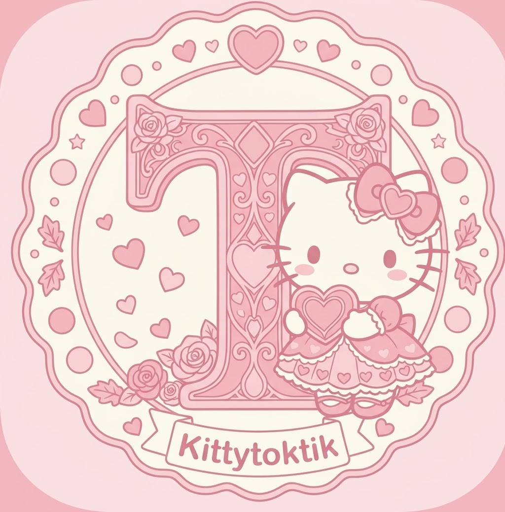
  <br>
  <strong>Desliza · Reproduce · Explora</strong>
  <br>
  Aplicación móvil de videos verticales desarrollada con Flutter y Dart.
</p>

<p align="center">
  
  
  
  
</p>

---

## 🎨 Identidad visual e iconos

La interfaz usa una base clara y rosada. El color de acento y la tipografía cambian con la temporada. Los cuatro iconos que ya están en `assets/icons/` se muestran aquí:

| Tema | Icono de la aplicación |
| --- | --- |
| Normal · rosa |  |
| Halloween · naranja |  |
| Navidad · rojo | 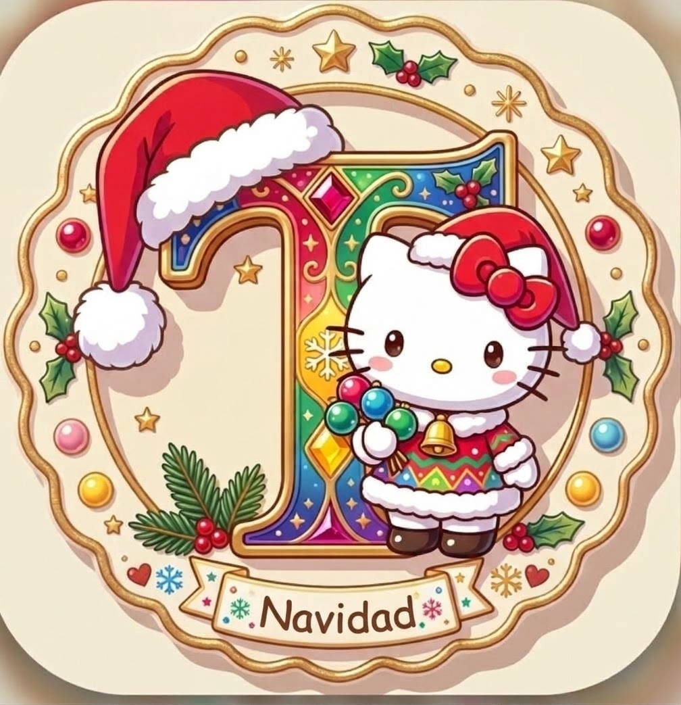 |
| San Valentín · rojo y rosa |  |

---

## 📑 Índice

1. [Descripción del proyecto](#-descripción-del-proyecto)
2. [Objetivos](#-objetivos)
3. [Funcionalidades](#-funcionalidades)
4. [Pantalla principal e iconos](#-pantalla-principal-e-iconos)
5. [Evidencias de la aplicación](#-evidencias-de-la-aplicación)
6. [Diseño e identidad visual](#-diseño-e-identidad-visual)
7. [Tecnologías utilizadas](#-tecnologías-utilizadas)
8. [Arquitectura del proyecto](#️-arquitectura-del-proyecto)
9. [Instalación y ejecución](#️-instalación-y-ejecución)
10. [Validación y pruebas](#-validación-y-pruebas)
11. [Alcance y mejoras futuras](#-alcance-y-mejoras-futuras)
12. [Datos académicos](#-datos-académicos)

---

## 📖 Descripción del proyecto

**KittyTokTik** es una aplicación móvil desarrollada con Flutter y Dart que permite visualizar videos en formato vertical mediante una interfaz dinámica e intuitiva.

Su diseño está inspirado en las plataformas de videos cortos, donde el contenido multimedia ocupa la mayor parte de la pantalla y el usuario puede desplazarse verticalmente para cambiar de video.

La aplicación integra un catálogo de videos locales, descripciones sobre el contenido, indicadores laterales y un reproductor multimedia. También utiliza Provider para administrar el estado y componentes reutilizables para mantener una estructura organizada.

El proyecto permite poner en práctica conocimientos de desarrollo móvil, programación asíncrona, reproducción multimedia, administración de estado y diseño de interfaces.

### 💡 Propósito

Desarrollar una aplicación móvil que permita explorar y reproducir videos verticales, aplicando herramientas de Flutter y una organización del código que facilite su mantenimiento y evolución.

## 🎯 Objetivos

### Objetivo general

Construir una aplicación de videos verticales con Flutter y Dart, implementando navegación mediante gestos, reproducción multimedia y administración del estado.

### Objetivos específicos

- Implementar un feed vertical mediante `PageView.builder`.
- Administrar el estado utilizando `Provider` y `ChangeNotifier`.
- Representar los videos mediante modelos y entidades.
- Reproducir archivos multimedia con `video_player`.
- Controlar la inicialización, pausa y reproducción de los videos.
- Presentar descripciones e indicadores visuales sobre el contenido.
- Aplicar degradados para mejorar la legibilidad del texto.
- Utilizar componentes reutilizables para organizar la interfaz.
- Formatear cantidades de manera compacta.
- Facilitar futuras ampliaciones de la aplicación.

## ✨ Funcionalidades

| Funcionalidad | Descripción |
|---|---|
| 🎞️ Feed vertical | Permite cambiar de video mediante desplazamientos verticales. |
| ▶️ Reproducción multimedia | Inicializa y reproduce los archivos de video. |
| ⏸️ Pausa y reanudación | Permite pausar o reanudar el video al tocarlo. |
| 🔊 Sonido | Configura el reproductor con sonido activado. |
| 📝 Descripciones | Muestra información relacionada con cada video. |
| ❤️ Indicador de Me gusta | Presenta un icono y una cantidad del catálogo. |
| 👁️ Visualizaciones | Muestra cantidades de reproducciones. |
| ⚠️ Manejo de errores | Permite presentar fallos de inicialización. |
| 🎨 Temas estacionales | Contempla variaciones visuales según la temporada. |
| 📱 Interfaz vertical | Aprovecha el espacio de la pantalla móvil. |

Los Me gusta se guardan en las preferencias locales. Los comentarios se consultan para los videos compatibles; el marcador de Guardar es temporal y se reinicia al cerrar la pantalla.

## 📱 Pantalla principal e iconos

La pantalla principal muestra un video vertical acompañado por su descripción y una columna de acciones.

Estos son los iconos que utiliza la interfaz:

| Icono | Función | Referencia Flutter |
|---|---|---|
| ♡ / ❤️ | Me gusta y Me gusta activo | `Icons.favorite_border` / `Icons.favorite` |
| 💬 | Abrir comentarios | `Icons.mode_comment_outlined` |
| ▣ | Guardar en la pantalla actual | `Icons.bookmark_border_rounded` / `Icons.bookmark_rounded` |
| ◉ | Visualizaciones | `Icons.visibility_outlined` |
| 🔊 / 🔇 | Activar o silenciar | `Icons.volume_up` / `Icons.volume_off` |
| ▶ | Reanudar un video pausado | `Icons.play_arrow` |
| 🏠 / 🔎 / ♥ | Inicio, Discovery y Me gusta | `Icons.home_rounded`, `Icons.explore_rounded`, `Icons.favorite_rounded` |

## 🎃 Evidencias de Halloween

Capturas de la aplicación con el tema de Halloween:

| Inicio | Discovery |
|---|---|
| 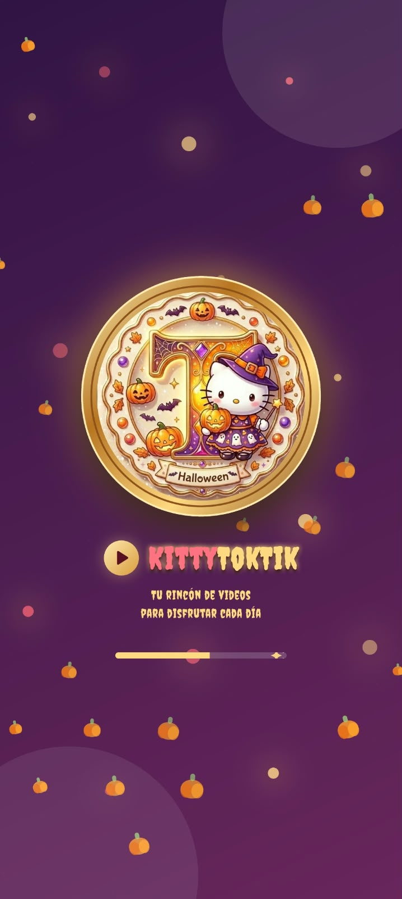 | 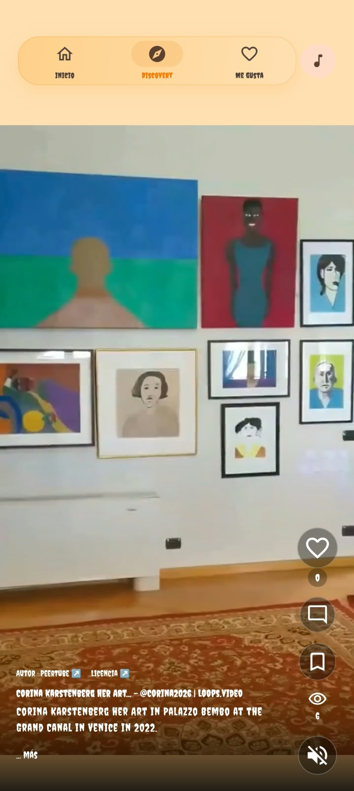 |

| Me gusta | Ajustes de temporada |
|---|---|
| 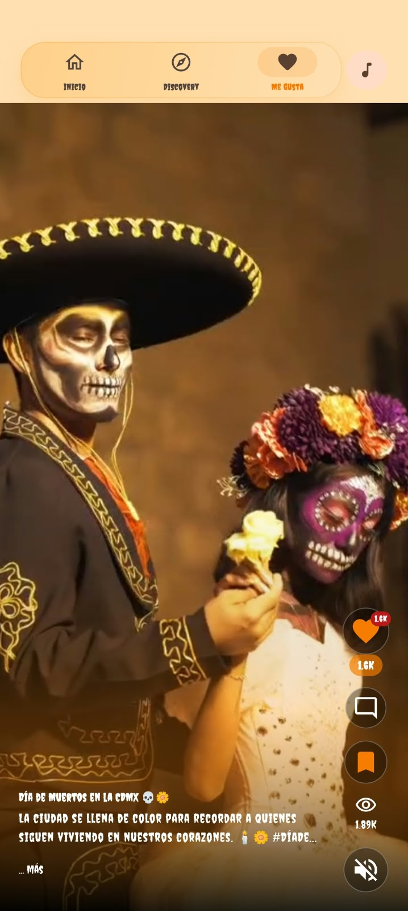 | 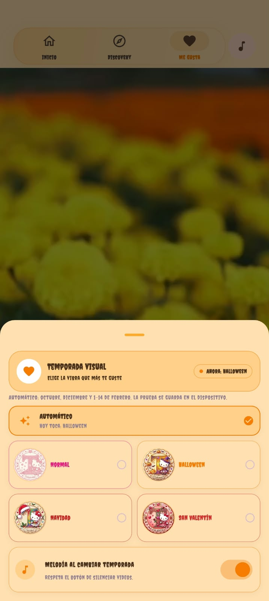 |

## 💝 Evidencias de San Valentín

Capturas de la aplicación con el tema de San Valentín:

| Inicio | Discovery |
|---|---|
|  | 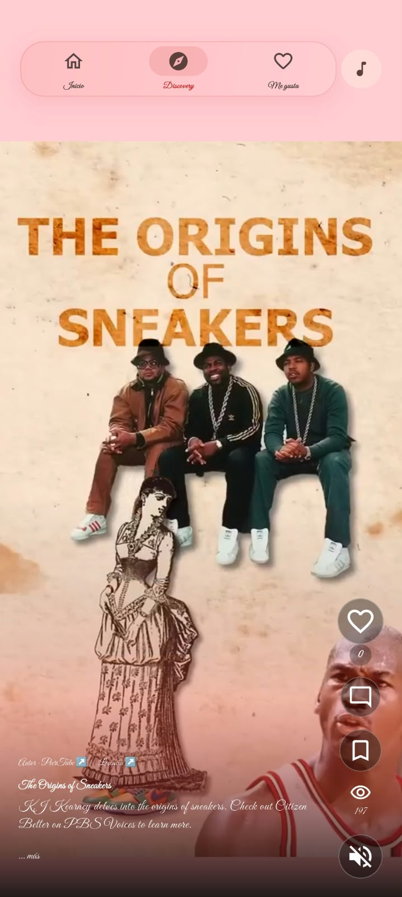 |

| Inicio · reproducción | Me gusta |
|---|---|
| 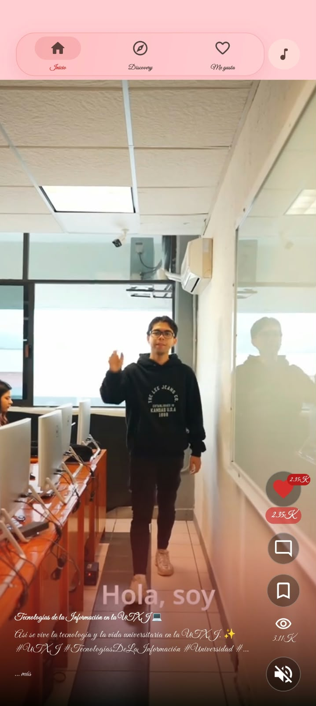 | 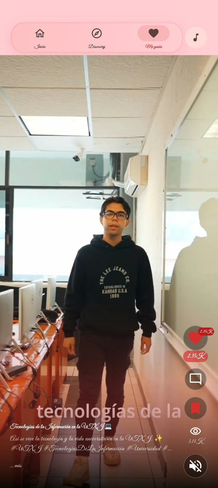 |

## 🎄 Evidencias de Navidad

Capturas de KittyTokTik con el tema navideño:

| Inicio | Discovery |
|---|---|
| 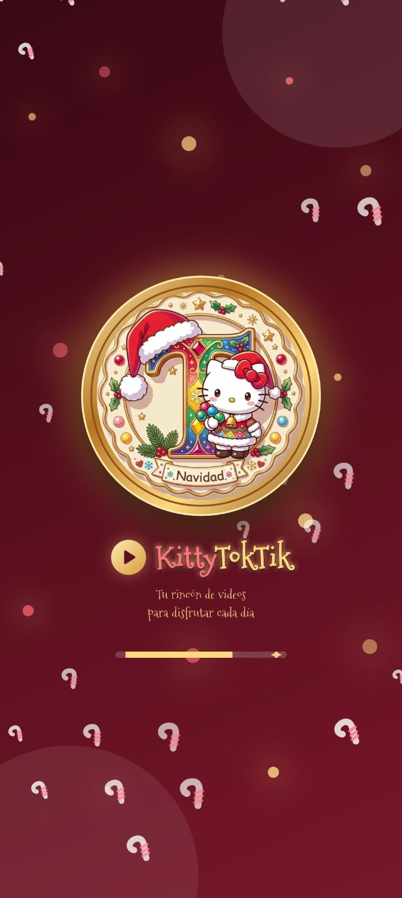 | 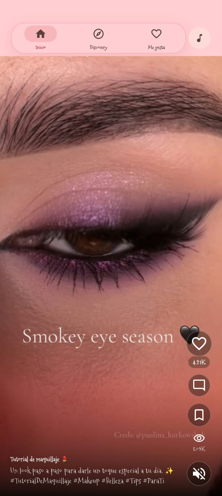 |

| Inicio · video | Selector de temporada |
|---|---|
| 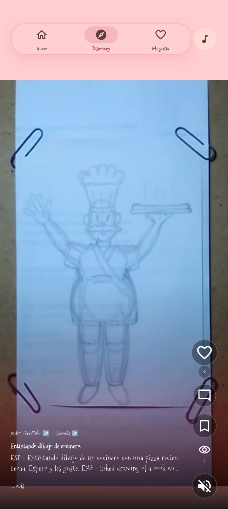 | 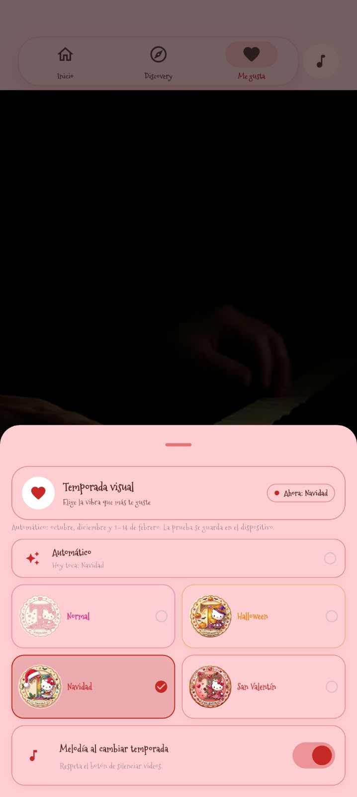 |

## ✨ Evidencias del tema normal

Capturas de KittyTokTik con el tema normal:

| Inicio | Discovery |
|---|---|
| 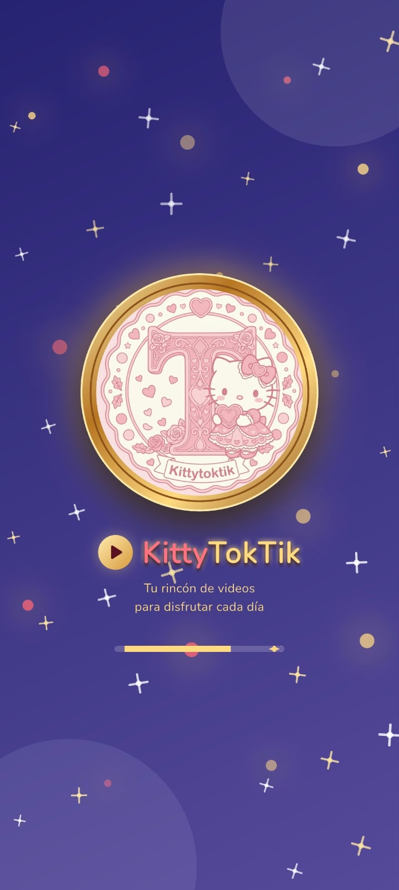 | 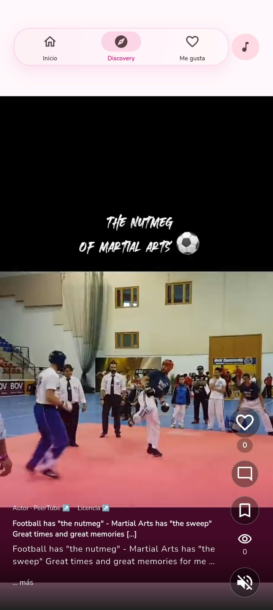 |

| Para ti | Me gusta y selector de temporada |
|---|---|
|  | 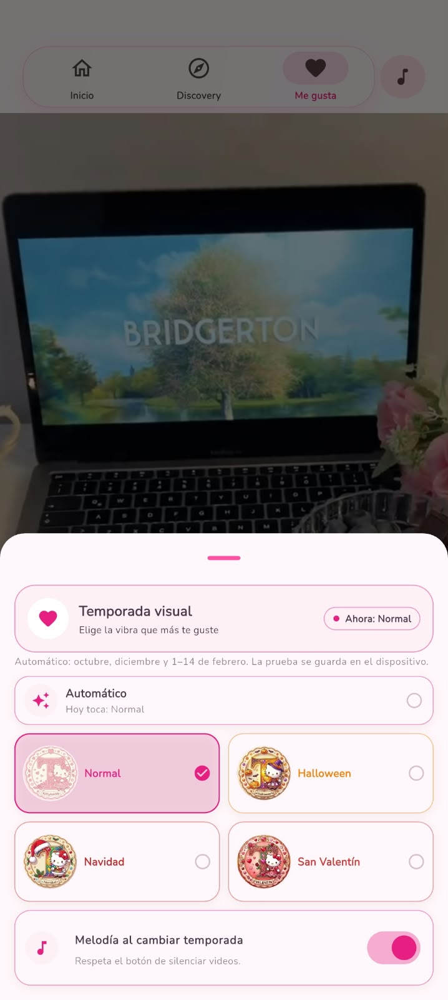 |


## 🎨 Diseño e identidad visual

KittyTokTik usa superficies claras en tonos rosados. El video ocupa el área principal y usa un degradado oscuro detrás de los textos y controles para que sigan siendo legibles.

### Características del diseño

- Fondo rosa muy claro en las pantallas de navegación.
- Acentos de color que cambian según la temporada.
- Tipografía Nunito durante la temporada normal.
- Tipografías temáticas para Halloween, Navidad y San Valentín.
- Degradado oscuro sobre la parte inferior del video.
- Iconos de acciones y navegación de Material.
- Icono de aplicación propio para cada temporada.

### Paleta de colores

| Tema | Color primario | Acento secundario | Fondo | Superficie |
|---|---|---|---|---|
| Normal | `#E91E83` | `#FF4FA0` | `#FFF7FB` | `#FFEFF6` |
| Halloween | `#F57C00` | `#FFA726` | `#FFE0B2` | `#FFD08A` |
| Navidad | `#C62828` | `#E57373` | `#FFCDD2` | `#FFCDD2` |
| San Valentín | `#D32F2F` | `#EF5350` | `#FFCDD2` | `#FFBFC2` |

### Tematización estacional

La aplicación contempla cambios visuales según la fecha local del dispositivo.

| Periodo | Tema | Apariencia |
|---|---|---|
| Octubre | Halloween | Naranja sobre fondo durazno; tipografía Creepster. |
| Diciembre | Navidad | Rojo y rosa claro; tipografía Mountains of Christmas. |
| Del 1 al 14 de febrero | San Valentín | Rojo y rosa; tipografía Great Vibes. |
| Resto del año | Normal | Rosa y fondo casi blanco; tipografía Nunito. |

La tematización se debe comprobar ejecutando la aplicación o mediante las pruebas correspondientes.

## 🛠️ Tecnologías utilizadas

| Tecnología | Uso |
|---|---|
| Flutter | Desarrollo de la interfaz multiplataforma. |
| Dart | Lenguaje de programación. |
| Provider | Administración y observación del estado. |
| `video_player` | Reproducción de archivos multimedia. |
| `intl` | Formato compacto de cantidades. |
| Git | Control de versiones. |
| GitHub | Alojamiento del repositorio. |
| Git LFS | Gestión de videos grandes, si está configurado. |

---

## Práctica: publicación de KittyTokTik en Appetize.io

### Objetivo

Preparar la aplicación Flutter KittyTokTik como APK Android de release, cargarla en Appetize.io, probarla en dos dispositivos Android y documentar evidencias verificables.

### Preparación y compilación

Desde la raíz del proyecto, con Flutter y Android SDK instalados:

```bash
flutter pub get
flutter build apk --release
```

El APK generado se encuentra en `build/app/outputs/flutter-apk/app-release.apk`. Appetize necesita el archivo `.apk` para Android; no se debe seleccionar un `.aab`.

### Publicación en Appetize.io

1. Abre [Appetize.io](https://appetize.io/) e inicia sesión.
2. Elige la opción para subir una aplicación Android y selecciona `build/app/outputs/flutter-apk/app-release.apk`.
3. Espera el procesamiento y abre la aplicación desde el panel.
4. Comprueba que el feed se inicie y que el video y controles visibles respondan.
5. Copia el enlace de prueba generado por Appetize y reemplaza el marcador siguiente. El enlace aún no se ha proporcionado ni se ha subido la aplicación desde este entorno.

**Enlace real de Appetize:** `PENDIENTE: pegar aquí el enlace generado por Appetize.io`.


### Plan y resultados de pruebas

Completa el modelo, versión de Android y resultado después de ejecutar cada prueba en Appetize. Se requieren dos dispositivos Android distintos; Appetize puede permitir seleccionar perfiles de dispositivo, pero los resultados deben anotarse únicamente después de observar la ejecución.

| Dispositivo Android | Modelo / perfil | Prueba | Resultado observado | Evidencia |
|---|---|---|---|---|
| 1 | Pendiente de probar | Abrir KittyTokTik y cargar el primer video | Pendiente | `evidencias/02-prueba-dispositivo-1.png` |
| 1 | Pendiente de probar | Deslizar al siguiente video y comprobar reproducción | Pendiente | `evidencias/04-navegacion-feed.png` |
| 2 | Pendiente de probar | Abrir KittyTokTik y cargar el primer video | Pendiente | `evidencias/03-prueba-dispositivo-2.png` |
| 2 | Pendiente de probar | Deslizar al siguiente video y comprobar reproducción | Pendiente | `evidencias/04-navegacion-feed.png` |

### Resultado de compilación local

| Comprobación | Resultado |
|---|---|
| `flutter pub get` | Correcto: dependencias resueltas |
| `flutter analyze` | Correcto: sin incidencias tras retirar un import innecesario |
| `flutter build apk --release` | Correcto: compilación release finalizada |
| `flutter test` | 39 pasaron, 4 fallaron y 1 se omitió; detalles abajo |
| Archivo APK | `build/app/outputs/flutter-apk/app-release.apk` (232.8 MB) |

Fallos observados en `flutter test`:

- `features_test.dart`: una prueba espera 13 videos locales, pero actualmente el proyecto contiene 5 archivos MP4.
- `widget_test.dart`: la prueba de “Para ti” no encuentra esa pestaña en el árbol durante la prueba.
- `widget_test.dart`: la prueba del selector toca “Navidad” fuera del área visible del dispositivo de prueba y no aplica la temporada.
- `widget_test.dart`: la prueba del splash espera el texto “Vdry · San Valentín”, mientras que el splash implementado muestra el nombre “KittyTokTik”.

Estos resultados requieren revisión antes de declarar toda la suite correcta. No se agregaron videos ni se alteró la interfaz para forzar el pase de pruebas.
| Carga en Appetize | Pendiente de realizar desde una cuenta Appetize |

### Conclusiones

La compilación Android release está lista y el análisis estático no reporta incidencias. La publicación todavía no está completa: falta subir el APK desde una cuenta Appetize, comprobar el enlace y ejecutar las pruebas en dos perfiles Android distintos. Completa la tabla y agrega las capturas reales antes de entregar.

### Git: guardar y subir los cambios

El repositorio ya tiene cambios locales anteriores a esta práctica. Antes de confirmar, revisa `git status` y conserva esos cambios. No uses `git reset --hard`, `git clean` ni agregues todo con `git add .` sin revisar, porque podrías descartar o subir archivos ajenos a esta práctica.

```bash
git status --short --branch
git switch -c practica/publicacion-appetize
git add README.md
git diff --cached --stat
git diff --cached
git commit -m "docs: documentar publicación de KittyTokTik en Appetize"
git push -u origin practica/publicacion-appetize
```

Si `git switch -c` indica que la rama ya existe, usa `git switch practica/publicacion-appetize`. Antes de confirmar, revisa los archivos que vas a incluir. El APK dentro de `build/` no se agrega a Git.

## 🏗️ Arquitectura del proyecto

La aplicación organiza sus componentes en carpetas que separan la presentación, los datos, los modelos, las entidades y la configuración.

### Estructura de directorios

```text
toktik/
├── lib/
│   ├── main.dart
│   ├── config/
│   │   ├── helpers/
│   │   │   └── human_formats.dart
│   │   └── theme/
│   │       └── app_theme.dart
│   ├── domain/
│   │   └── entities/
│   │       └── video_post.dart
│   ├── infraestructure/
│   │   └── models/
│   │       └── local_video_model.dart
│   ├── shared/
│   │   └── data/
│   │       └── local_video_post.dart
│   └── presentation/
│       ├── providers/
│       │   └── discover_provider.dart
│       ├── screen/
│       │   └── discover/
│       │       └── discover_screen.dart
│       └── widgets/
│           ├── shared/
│           └── video/
├── assets/
│   ├── videos/
│   ├── screenshots/
│   ├── icon/
│   └── fonts/
├── pubspec.yaml
└── README.md
