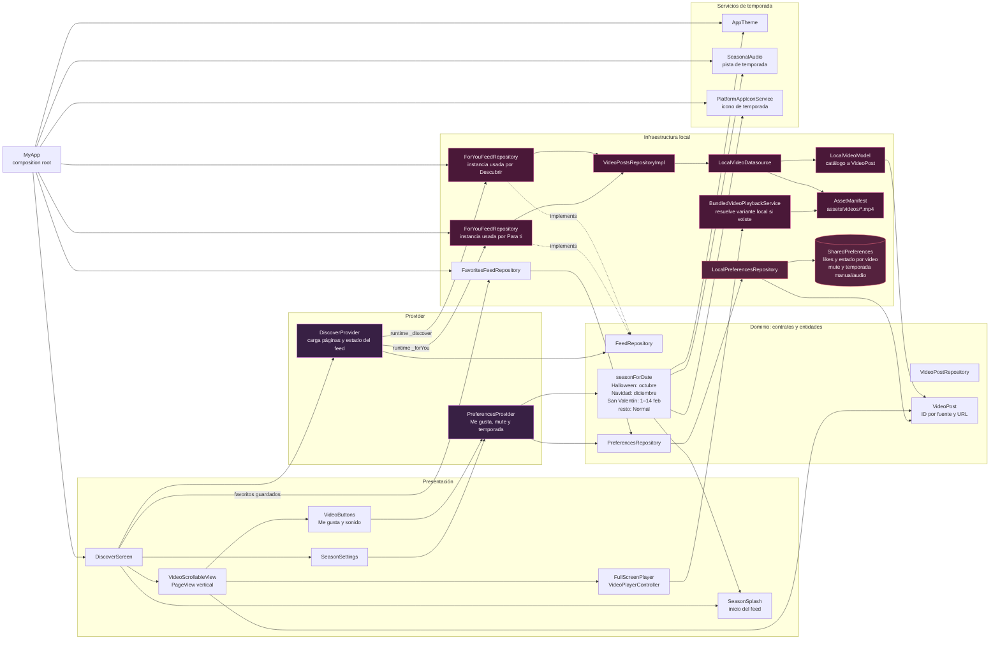

# KittyTokTik — diagramas de arquitectura para la Práctica 04

Los diagramas reflejan el código de este checkout. Las líneas continuas representan dependencias o flujos implementados. Las líneas punteadas marcan conexiones alternativas no activas o por implementar; los nodos **FALTANTE** identifican piezas solicitadas que no existen en el código.

> Nota: `seccion_8_toktik_arquitectura_interna.html` describe 13 videos locales y tres APIs activas, lo cual no coincide con el `main.dart` y los assets actuales. Este Markdown documenta el cableado real encontrado en el proyecto.

## 1. Provider local: interfaz, videos, preferencias y temporadas

**Elaborado por:** Jennifer Bautista Barrios | **Matricula:** 230317

`MyApp` crea los feeds locales, `PreferencesProvider` y el servicio de reproducción. `DiscoverScreen` crea un `DiscoverProvider` por feed. Actualmente **Descubrir y Para ti reciben ambos un `ForYouFeedRepository` local**. Favoritos consulta los videos marcados en las preferencias persistidas.



### Resumen

- El feed local lee los MP4 del `AssetManifest`; `LocalVideoModel` transforma los metadatos locales en entidades `VideoPost`.
- Los botones y el selector de temporada usan `PreferencesProvider`. `LocalPreferencesRepository` persiste sus valores en `SharedPreferences`.
- La temporada efectiva respeta el override manual; si está en Automático, usa `seasonForDate`. Esa misma temporada determina tema, splash, audio e icono.
- No hay una capa de casos de uso en este flujo: los providers llaman directamente a contratos de feed/preferencias.

## 2. Provider y Clean Architecture: repositorios y fuentes

**Elaborado por:** Jennifer Bautista Barrios | **Matricula:** 230317

Este diagrama separa lo que ya existe de lo que pide el enunciado pero falta. El `DiscoverFeedRepository` y las fuentes HTTP están implementados, pero `main.dart` **no los instancia** en este checkout. Las fuentes reales son PeerTube, Internet Archive y Wikimedia Commons; YouTube, Vimeo y Dailymotion no tienen datasources aquí.

```mermaid
flowchart LR
  subgraph Presentation[Presentación]
    Screen[DiscoverScreen]
    ProviderFeed[DiscoverProvider]
    ProviderPrefs[PreferencesProvider]
    Screen --> ProviderFeed
    Screen --> ProviderPrefs
  end

  subgraph Domain[Dominio]
    FeedPort[FeedRepository<br/>contrato]
    VideoRepoPort[VideoPostRepository<br/>contrato]
    DataPort[VideoPostDatasource<br/>contrato]
    Entity[VideoPost<br/>entidad]
    UseCases[Casos de uso<br/>FALTAN]
    VideoMapper[Mapper remoto API → VideoPost<br/>FALTA como componente separado]
  end

  subgraph Infrastructure[Infraestructura implementada]
    DiscoverRepo[DiscoverFeedRepository<br/>combina fuentes progresivamente]
    VideoRepo[VideoPostsRepositoryImpl]
    DirectBase[DirectVideoDatasource<br/>HTTP y caché de metadatos]
    LocalDS[LocalVideoDatasource]
    LocalMapper[LocalVideoModel<br/>mapper local existente]
    PeerTube[PeerTubeVideoDatasource]
    Archive[InternetArchiveVideoDatasource]
    Wikimedia[WikimediaVideoDatasource]
  end

  subgraph External[Servicios externos implementados]
    Sepia[Sepia Search + instancia PeerTube]
    IA[Internet Archive API]
    WC[Wikimedia Commons API]
    Manifest[AssetManifest y MP4 locales]
  end

  subgraph Missing[Fuentes solicitadas que faltan]
    YouTube[YouTube datasource<br/>FALTA]
    Vimeo[Vimeo datasource<br/>FALTA]
    Daily[Dailymotion datasource<br/>FALTA]
  end

  Composition[main.dart actual] --> LocalFeed[ForYouFeedRepository ×2<br/>Descubrir y Para ti]
  Composition --> Screen
  Screen --> LocalFeed
  Composition --> VideoRepo
  ProviderFeed -->|usa contrato directamente| FeedPort
  ProviderFeed -->|instancia en ejecución| LocalFeed
  LocalFeed -. implementa .-> FeedPort
  LocalFeed --> VideoRepo
  FeedPort -. implementación disponible pero no inyectada .-> DiscoverRepo
  DiscoverRepo --> VideoRepoPort
  VideoRepoPort --> VideoRepo
  VideoRepo --> DataPort
  DataPort --> LocalDS
  LocalDS --> LocalMapper --> Entity
  LocalDS --> Manifest

  DiscoverRepo -. fuente implementada, no conectada en main.dart .-> PeerTube
  DiscoverRepo -. fuente implementada, no conectada en main.dart .-> Archive
  DiscoverRepo -. fuente implementada, no conectada en main.dart .-> Wikimedia
  PeerTube --> DirectBase --> Sepia
  Archive --> DirectBase --> IA
  Wikimedia --> DirectBase --> WC
  PeerTube --> Entity
  Archive --> Entity
  Wikimedia --> Entity

  ProviderFeed -. capa solicitada que falta .-> UseCases
  UseCases -. llamaría al contrato .-> FeedPort
  PeerTube -. mapper separado solicitado .-> VideoMapper
  Archive -. mapper separado solicitado .-> VideoMapper
  Wikimedia -. mapper separado solicitado .-> VideoMapper
  VideoMapper -. produce .-> Entity

  YouTube -. pendiente de implementar .-> DiscoverRepo
  Vimeo -. pendiente de implementar .-> DiscoverRepo
  Daily -. pendiente de implementar .-> DiscoverRepo

  classDef implemented fill:#4a1838,stroke:#f472b6,color:#fff5fa;
  classDef missing fill:#51203a,stroke:#fb7185,color:#fff5f7,stroke-dasharray:5 5;
  classDef external fill:#4c2547,stroke:#f0abfc,color:#fff7ff;
  class DiscoverRepo,VideoRepo,DirectBase,LocalDS,LocalMapper,PeerTube,Archive,Wikimedia implemented;
  class UseCases,VideoMapper,YouTube,Vimeo,Daily missing;
  class Sepia,IA,WC,Manifest external;
```

### Resumen y faltantes

- **No hay casos de uso** en `lib/domain`; `DiscoverProvider` llama directamente a `FeedRepository`.
- **Sí hay un mapper local**, `LocalVideoModel.toVideoPostEntity()`. Las fuentes HTTP construyen `VideoPost` dentro de cada datasource; no existe un mapper remoto separado.
- **No existen datasources de YouTube, Vimeo o Dailymotion.** El enum `VideoSource` conserva esos nombres históricos, pero eso no implementa consumo de esas plataformas.
- Sí existen PeerTube, Internet Archive y Wikimedia Commons, junto con `DiscoverFeedRepository` para combinarlos progresivamente. Actualmente no se conectan en `main.dart`; las pestañas Descubrir y Para ti reciben feeds locales.

## Archivos comprobados

- Composición e inyección: `lib/main.dart`
- Pantalla y providers: `lib/presentation/screens/discover/discover_screen.dart`, `lib/presentation/providers/`
- Contratos: `lib/domain/repositories/`, `lib/domain/datasources/video_posts_datasource.dart`
- Repositorios y datasources: `lib/infrastructure/repositories/`, `lib/infrastructure/datasources/`
- Mapper local: `lib/infrastructure/models/local_video_model.dart`
- Preferencias: `lib/infrastructure/repositories/local_preferences_repository.dart`
