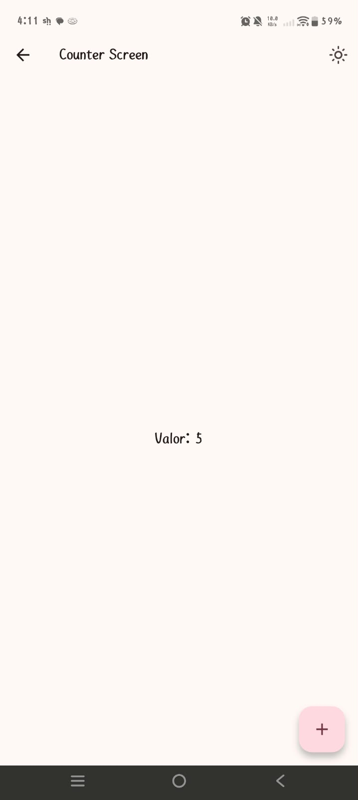
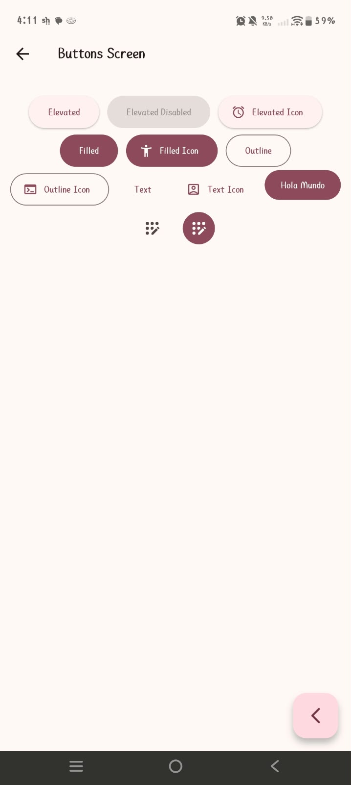
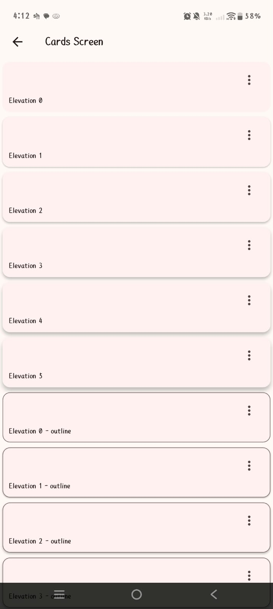
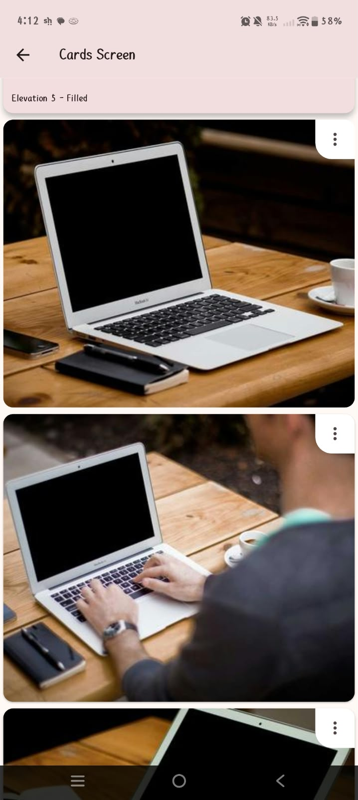
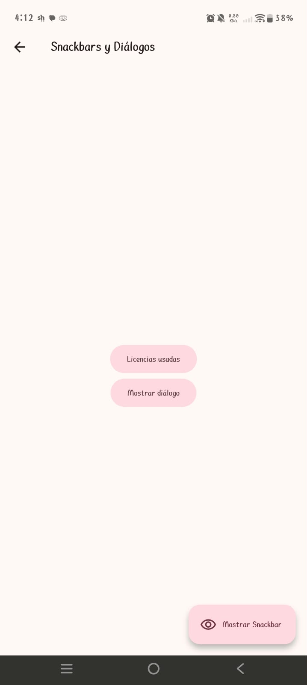
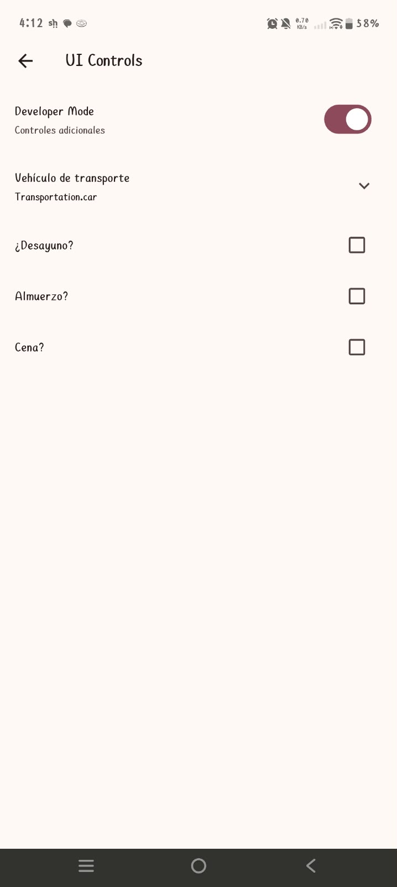
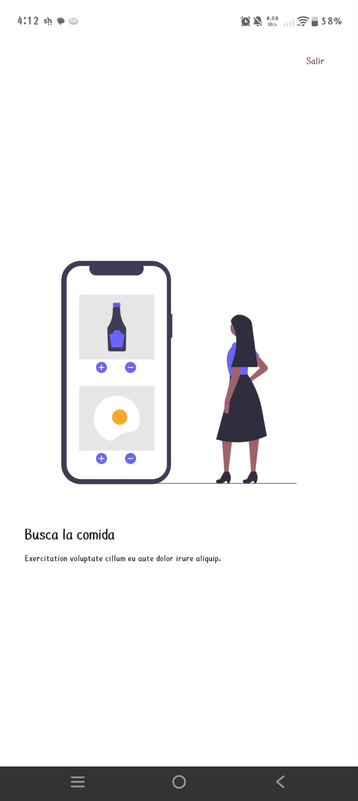
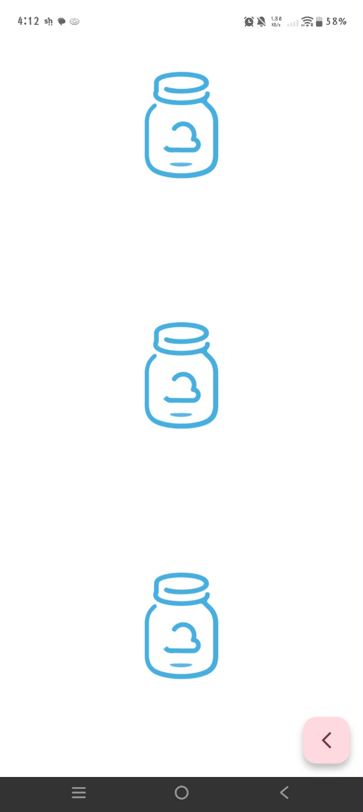
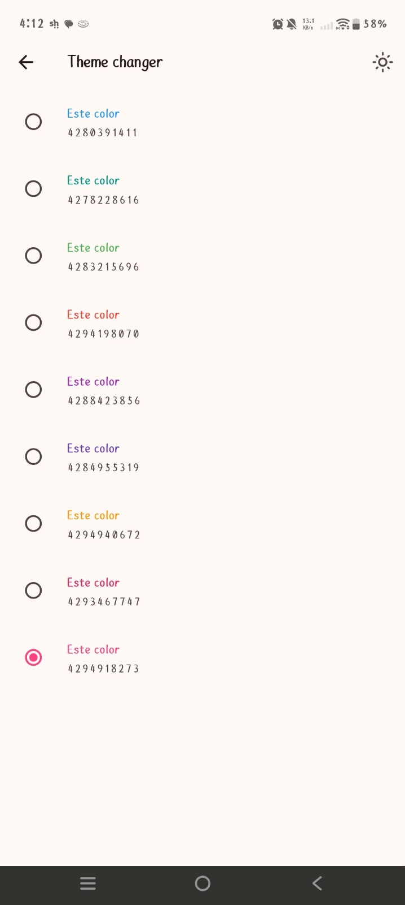
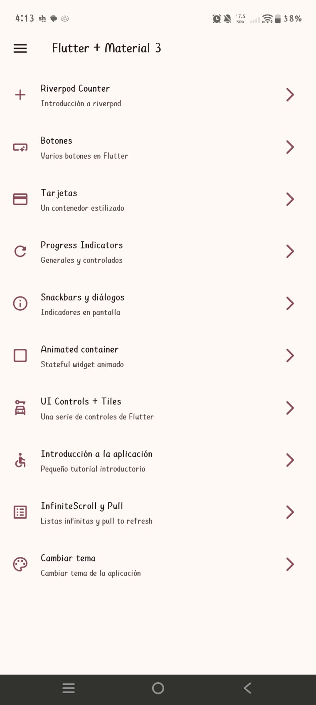

# Práctica 05 — Widgets App 🚀

<p align="center">
  
  &nbsp;&nbsp;&nbsp;&nbsp;&nbsp;&nbsp;&nbsp;&nbsp;
  
</p>

<p align="center">
  
  
  
  
  
</p>

---

📱 Evidencia de Funcionamiento

<p align="center">
<i>Pruebas ejecutadas en un dispositivo móvil Android físico.</i>
</p>

### 📸 Capturas Principales (1 al 5)

<table>
<tr>
<th align="center">Imagen 1</th>
<th align="center">Imagen 2</th>
<th align="center">Imagen 3</th>
</tr>
<tr>
<td align="center">

</td>
<td align="center">

</td>
<td align="center">

</td>
</tr>
<tr>
<td align="center"><b>Menú principal con GoRouter</b></td>
<td align="center"><b>Demostración de componentes</b></td>
<td align="center"><b>Selector de color (Riverpod)</b></td>
</tr>
</table>

<table>
<tr>
<th align="center">Imagen 4</th>
<th align="center">Imagen 5</th>
</tr>
<tr>
<td align="center">

</td>
<td align="center">

</td>
</tr>
<tr>
<td align="center"><b>Evidencia adicional de funcionamiento</b></td>
<td align="center"><b>Demostración adicional de widgets</b></td>
</tr>
</table>

### 📸 Capturas Adicionales (6 al 10)

<table>
<tr>
<th align="center">Imágenes 6</th>
<th align="center">Imágenes 7</th>
<th align="center">Imagen 8</th>
</tr>
<tr>
<td align="center">

</td>
<td align="center">

</td>
<td align="center">

</td>
</tr>
<tr>
<td align="center"><b>Controles e interfaz de usuario</b></td>
<td align="center"><b>Indicadores de progreso y mensajes</b></td>
<td align="center"><b>Tutorial onboarding y animación</b></td>
</tr>
</table>

<table>
<tr>
<th align="center">Imagen 9</th>
<th align="center">Imagen 10</th>
</tr>
<tr>
<td align="center">

</td>
<td align="center">

</td>
</tr>
<tr>
<td align="center"><b>Carga dinámica y scroll infinito</b></td>
<td align="center"><b>Gestión de estado e interacción</b></td>
</tr>
</table>

---

## 📌 Objetivo
Desarrollar una aplicación interactiva en **Flutter** para explorar la biblioteca de componentes de **Material 3**, implementar patrones de navegación avanzada con `GoRouter` y gestionar el estado global mediante **Riverpod**. Cada sección del proyecto demuestra interacciones, animaciones y componentes específicos dentro de un flujo unificado.

---

## 🏗️ Diagrama de Arquitectura

> 🔗 **[Ver el Diagrama Interactivo en GitHub Pages](https://jenniferbautistabarrios.github.io/Practicas_DMI_230317/Practica05/arquitectura/arquitectura-practica05.html)**

<p align="center">
  
</p>

---

## ✨ Funcionalidades

| Componente / Módulo | Descripción |
| :--- | :--- |
| **🪟 Navegación** | Menú lateral (*Drawer*) y rutas declarativas gestionadas con `GoRouter`. |
| **🔘 Botones y Tarjetas** | Variantes completas de botones de Material 3 y tarjetas con elevaciones, bordes y multimedia. |
| **⏳ Indicadores de Progreso** | Controles circulares y lineales (controlados de forma reactiva y no controlados). |
| **💬 Mensajes y Diálogos** | Notificaciones con `SnackBar`, diálogos emergentes de confirmación y vista de licencias. |
| **✨ Animaciones** | Contenedor interactivo (`AnimatedContainer`) que altera tamaño, color y radio aleatoriamente. |
| **🎛️ Controles de Interfaz** | Formulario con interruptores (`Switch`), botones de radio (`RadioListTile`) y casillas (`Checkbox`). |
| **📖 Tutorial Onboarding** | Carrusel guiado de 3 pantallas con ilustraciones locales y botones de navegación rápida. |
| **🔄 Lista Infinita** | Carga dinámica de imágenes con `picsum.photos`, recarga por deslizamiento (*Pull-to-refresh*) y *scroll infinito*. |
| **🎨 Estado con Riverpod** | Contador reactivo y selector global de tema (modo claro/oscuro y paletas de color personalizadas). |

---

## 💡 Descripción de la Solución

1. **Punto de Entrada (`main.dart`):** Envuelve la aplicación dentro de un `ProviderScope` e inicializa `MaterialApp.router`.
2. **Navegación:** `GoRouter` registra la pantalla principal y las 10 demostraciones accesibles desde el menú lateral.
3. **Gestión de Tema:** Diseñado con **Material 3**. El estado es controlado por `ThemeNotifier`, permitiendo alternar el modo oscuro y cambiar el color de acento dinámicamente en toda la aplicación.
4. **Recursos y APIs:** Las imágenes locales del tutorial se alojan en `assets/images/`, mientras que las tarjetas y la lista infinita consumen contenido remoto desde `picsum.photos`.

---

## 🛠️ Tecnologías Utilizadas

- **Framework:** Flutter & Dart
- **Diseño:** Material 3
- **Gestión de Estado:** `flutter_riverpod`
- **Enrutamiento:** `go_router`
- **Animaciones:** `animate_do`
- **Fuentes de Datos:** API de `picsum.photos`

---

## 🚀 Cómo Ejecutar el Proyecto

Navega a la carpeta del proyecto ejecutable (`widgets_app`) y ejecuta los siguientes comandos:

```bash
# Obtener las dependencias
flutter pub get

# Ejecutar la aplicación
flutter run